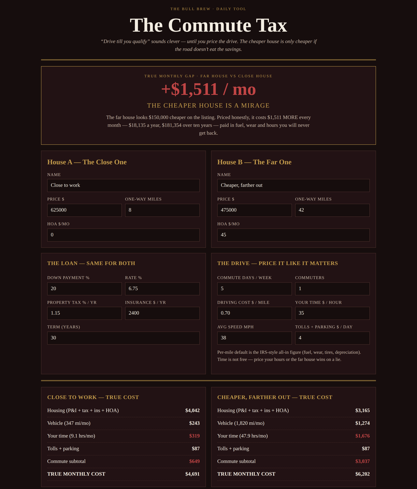

# The Commute Tax

**Live:** https://thebullbrew.github.io/commute-tax/
**Repo:** https://github.com/thebullbrew/commute-tax

## What it does

"Drive till you qualify" sounds clever — until you price the drive. This tool compares a close, expensive house against a far, cheap one on **true monthly cost**: mortgage, tax, insurance and HOA on both sides, plus the full cost of the commute — vehicle miles at an all-in per-mile rate, tolls and parking, and your own hours behind the wheel valued at your rate.

You get a plain verdict — THE CHEAPER HOUSE IS A MIRAGE, WORTH THE DRIVE, or A WASH — the 10-year toll, extra hours and miles per year, a solved **breakeven price for the far house** (what it would actually have to cost for the drive to be worth it), and a 1–5 commute-days sensitivity table that shows how much the answer depends on hybrid work. Comparisons save locally and copy as a clean summary.

Built for homebuyers stretching their search radius, and anyone whose "saving" lives an hour down the highway.

## The method

1. Never compare prices. Compare true monthly costs.
2. Miles are a bill, not a feeling — fuel, wear, tires and depreciation whether you feel them that day or not.
3. Time is the silent tax: an extra hour a day is 250+ hours a year, unpaid, in traffic.
4. Breakeven tells the truth: if the far house is listed above its breakeven price, the road eats the deal.

Design: Dark aesthetic variation 2 — Oxblood Study.

## How to run

Open `docs/index.html` in any browser, or serve the `docs/` folder with any static host. Works offline as a PWA. No backend, no accounts, all data stays in your browser (localStorage).
